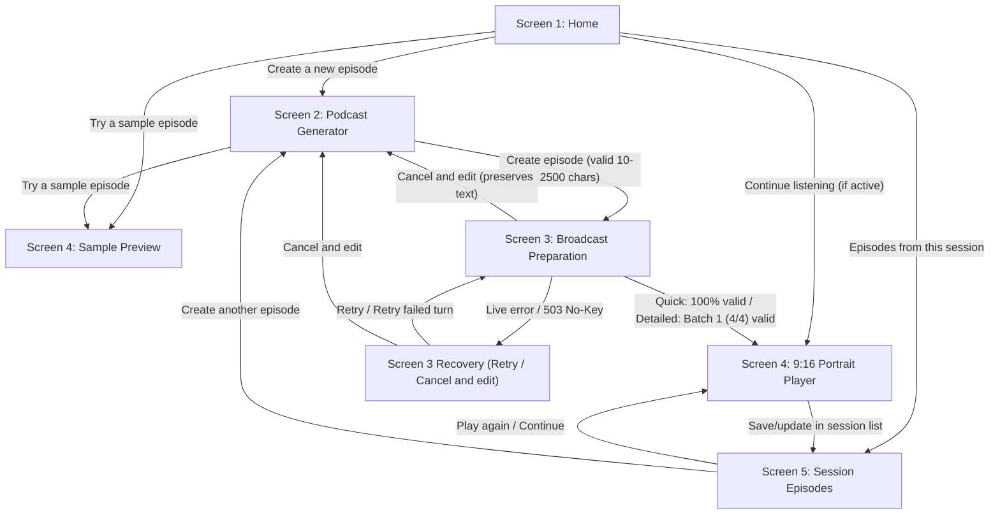

# WP-012.5 — User Workflows & State Transitions

> **Package:** `WP-012.5` — Product Experience Architecture and Workflow Prototype *(Owner-Led: Jendrick)*
> **Baseline:** `origin/main` `fe21cf1` (`WP-012` + roadmap sync merged; implemented via `KuroAppShell` + `useSessionEpisodes`) `[Verified]`

---

## 1. End-to-End Flow Overview (`[Proposed]`)

All five screens connect through deterministic state transitions backed by existing `CreateEpisodeRequestSchema` (`contracts/episode.schema.ts` `[Verified]`), `/api/episodes`, `/api/tts`, and `EpisodeBatchCompilerController` (`src/lib/tts/episode-batch-compiler.ts` `[Verified]`).

---

## 2. Create Flow (`Screen 1 -> Screen 2 -> Screen 3`) (`[Proposed]` & `[Verified]`)

1. User enters **Screen 1 (Home)** and selects **`Create a new episode`** (or taps `Create` in nav).
2. **Screen 2 (Podcast Generator)** presents a focused single-purpose form preserving all `CreateEpisodeRequestSchema` contracts `[Verified]`:
   - **Topic or pasted study material:** `textarea` enforcing `10–2,500` trimmed characters (`INPUT_MIN_CHARS` / `INPUT_MAX_CHARS`), live character count (`tabular-nums`), clear validation feedback, and quick prompt-starter chips optional without cluttering the form.
   - **Tone:** `Casual` (default) or `Serious`.
   - **Length:** `Quick` (`8–10` turns, default) or `Detailed` (`12–15` turns).
   - **Kuromates:** `2` (default) or `3` hosts (`hosts[]` dynamic `[Verified]`).
   - **Compact Selected-Cast Preview:** Shows the selected 2 or 3 Kuromate seats/roles cleanly before generation without prematurely mounting the full player.
   - **Actions:** Primary **`Create episode`** button + subtle secondary **`Try a sample episode`**.
3. Submitting valid inputs disables duplicate submission (`isSubmittingRef` guard `[Verified]`), stores the draft in state so **`Cancel and edit`** never loses user text, and transitions into **Screen 3 (Unified Broadcast Preparation)**.
4. Any `POST /api/episodes` validation, rate-limit, or network error returns cleanly with `RecoverableErrorCard` (`Try again` / `Edit notes`) while keeping all form inputs intact `[Verified]`.

---

## 3. Sample Flow (`Screen 1 / 2 / 5 -> Screen 4 Sample Preview`) (`[Verified]` & `[Proposed]`)

1. Triggered via **`Try a sample episode`** on Home, Generator, or Session Episodes.
2. Loads `getSampleEpisode()` (`fixtures/episode.quick.two-host.json`, `status: "mock"`, zero bundled audio files `[Verified]`).
3. Enters **Screen 4** with `source === "sample"`, **`0` `/api/tts` requests**, and an explicit **`Sample Preview`** badge (`"Preview mode with timed captions — live voice generation not invoked"`).
4. Supports timed playback (`Play`, `Pause`, `Prev`, `Next`, `Replay`), all 5 editorial shot cuts, contextual visual sync, and `.txt` transcript download, while keeping **`Download Audio (.wav)` disabled** (`canDownloadAudio === false` `[Verified]`).
5. **Crucial rule:** Sample Preview **never** implies live TTS keys are configured and **never** silently substitutes for a live generated episode.

---

## 4. Generation Flow (`Screen 3 — Unified Broadcast Preparation`) (`[Proposed]` & `[Verified]`)

1. Remains inside **one continuous studio-opening panel** across script creation, schema validation, and opening/full audio compilation (`test:audio-queue` Check #44 prohibits a separate `audio-preparation-panel.tsx` `[Verified]`).
2. Visual beat sequence advances in sync with real state milestones (see [BROADCAST_PREPARATION.md](./BROADCAST_PREPARATION.md)):
   - `Writing the discussion` (`POST /api/episodes`)
   - `Checking the episode` (`EpisodeSchema` validation)
   - `Compiling hosted audio` / `Preparing the playable batch` (`EpisodeBatchCompiler` batches of 4)
   - `Ready to begin` (`Quick`: 100% turns valid + stitched `fullWavBlob` ready; `Detailed`: Batch 1 `4/4` turns valid + stitched Batch 0 WAV ready)
3. User clicks **`Start podcast`** (or auto-enters Screen 4 with explicit autoplay-blocked `Tap to start` fallback if browser blocks unmuted autoplay `[Verified]`).

---

## 5. Playback Flow (`Screen 4 — 9:16 Portrait Podcast Player`) (`[Proposed]` & `[Verified]`)

1. **Before entering playback (`NO AUDIO, NO ADVANCE` `[Verified]`):**
   - **Quick:** `100%` of turns (`8–10`) validated (`24 kHz` mono 16-bit PCM, `durationMs > 0`, matching `X-Kuro-TTS-Identity`) and stitched into one complete WAV (`fullWavBlob`), enabling Play, full `MM:SS` scrubbing, and `Download Audio (.wav)` from second `0`.
   - **Detailed:** Batch 1 (`turns 1–4`) 100% validated and stitched before Play; Batches `2..N` (`4` turns each) compile in background (`concurrency = 4` primary Deepgram; auto-downshifts to `1` + `1,500 ms` pacing if Gemini Flash-Lite fallback activates `[Verified]`).
2. **During playback:**
   - Audio clock (`requestAnimationFrame` + `ontimeupdate`) resolves `resolveTimelineStateAtMs()` deterministically to drive the active Kuromate shot, reaction host, synchronized caption, contextual visual, `MM:SS / MM:SS` time, and range scrubber.
   - Crossing a Detailed batch boundary is permitted **only** when the next batch is 100% compiled (`NO AUDIO, NO ADVANCE`). If incomplete, playback pauses cleanly at the boundary showing `Preparing turns 5–8…` (`isBufferingAtBoundary`) with Kuromates resting, resuming seamlessly at the exact boundary once ready `[Verified]`.
3. **Completion, Replay & Downloads:**
   - Replaying (`Replay`) reuses in-memory Blob URLs with **`0` extra `/api/tts` calls** (`[Verified]`).
   - Once all turns are compiled, `Download Audio (.wav)` (`kuro-episode-<slug>.wav`) unlocks without restarting playback `[Verified]`, alongside `Download Transcript (.txt)`.

---

## 6. Session Episode Flow (`Screen 4 <-> Screen 5 <-> Screen 2`) (`[Proposed]`)

1. When a live episode compiles cleanly (or reaches Batch 1 playable state in Detailed), the episode record + active audio state is registered in **in-memory session state** (`SessionEpisodeStore`, zero `localStorage` audio).
2. Navigating to **Screen 5 (`Episodes from this session`)** lets the user:
   - Inspect current-session episodes (title, topic snippet, Kuromate count, tone/length, duration/readiness, source badge) plus Built-in Sample and future `WP-018` backup entries.
   - Tap **`Play again` / `Continue`** → mounts Screen 4 directly from the retained compiled audio/state (`0` refetch if already compiled).
   - Tap **`Download .wav`** (when 100% compiled) or **`Download transcript (.txt)`**.
   - Tap **`Remove`** (revokes Blob URLs cleanly via `createEpisodeObjectUrlPool` `[Verified]`) or **`Create another episode`** → Screen 2.

---

## 7. Failure & Recovery Entry Points (`[Proposed]` & `[Verified]`)

Every live failure honors **`NO AUDIO, NO ADVANCE`** (zero silent turn skipping, zero live timed-caption bypass):

| Failure Point | Observed Trigger | User Surface & Recovery Actions | Next-State Preservation |
| --- | --- | --- | --- |
| **Script Generation Failure** | `/api/episodes` returns `400`, `429`, `502`, `503`, `504` | Returns cleanly from Screen 3 to recoverable error view on Screen 2 with `Try again` and `Edit notes`. | Preserves full pasted topic, tone, length, and Kuromate count. |
| **Live No-Key / Auth Block** | `/api/tts` returns `503 TTS_NOT_CONFIGURED` or `401`/`403` | Screen 3 pauses in blocking recovery card (`"Live voice generation is not configured"`), `Start podcast` disabled, offers `Retry` and `Cancel and edit`. | Zero live silent bypass; explicit `Try a sample episode` note clarifies sample is preview-only. |
| **Turn Compile Failure (Pre-Start)** | Transient `429`/`503`/`504`/bad WAV persists after server + 1 client auto-retry | Screen 3 pauses honestly (`failed-retryable` / `failed-blocking`), shows how many valid clips are already compiled (`e.g., 7 of 8 ready`), offers **`Retry failed turn`** (requests ONLY failed turn IDs) and **`Cancel and edit`**. | All valid PCM clips stay cached in memory. |
| **Detailed Batch-Boundary Failure** | Batch `2+` fails while Batch `1` was playing | Playback halts cleanly at batch boundary (`NO AUDIO, NO ADVANCE`), displays boundary error + **`Retry failed turns`**, keeping all compiled batches intact. | Resumes from exact interrupted boundary once failed turn succeeds. |
| **Aborted / Navigated Away** | User clicks **`Cancel and edit`** | `controller.cancel()` aborts in-flight fetches, clears timers, revokes temporary Blob URLs, returns to Screen 2. | Original form inputs stay editable immediately. |
